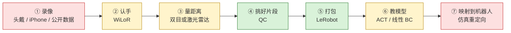
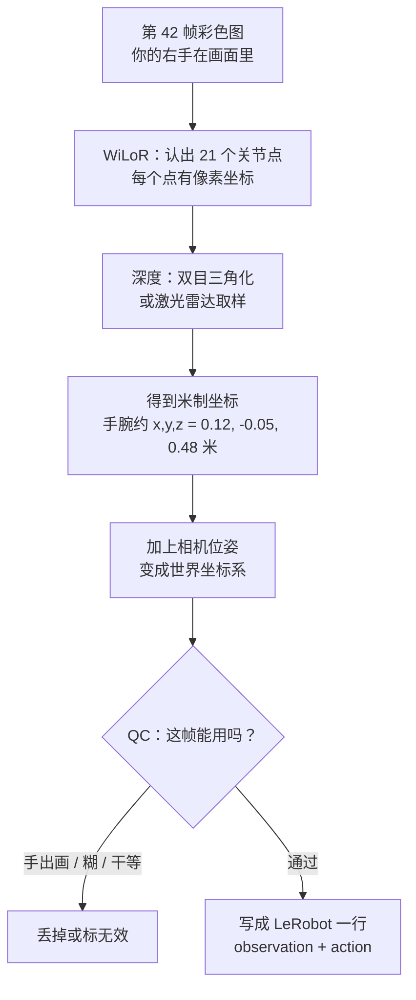
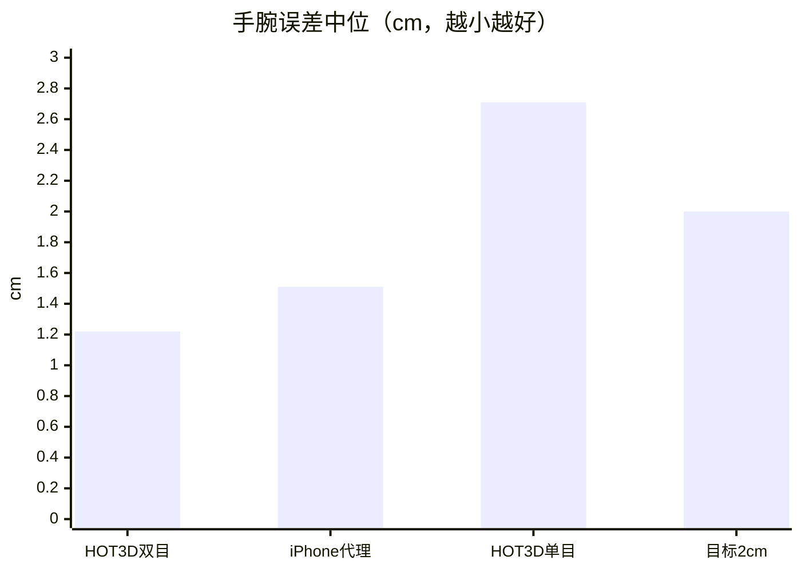
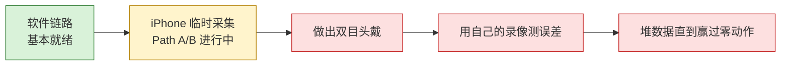

# robot 仓库新手图解指南

> 写给仓库主人 Justin（自称新手）。  
> 目标：用一张图、几个类比、短句子，把「这个仓库到底在干什么」讲明白。  
> 更新日期：2026-10-11。命令都对照过仓库里脚本的 `--help`，没有编造。
>
> HTML/PDF 离线版：[`docs/beginner_guide/guide.html`](beginner_guide/guide.html)、[`docs/beginner_guide/guide.pdf`](beginner_guide/guide.pdf)。

---

## 目录

1. [一张图看懂整个项目](#1-一张图看懂整个项目)
2. [仓库地图：哪些文件夹重要](#2-仓库地图哪些文件夹重要)
3. [数据之旅：跟一帧画面走一遍](#3-数据之旅跟一帧画面走一遍)
4. [流水线每一站（卡片）](#4-流水线每一站卡片)
5. [实验结果用人话说](#5-实验结果用人话说)
6. [名词小词典](#6-名词小词典)
7. [想做 X，就跑 Y（速查）](#7-想做-x就跑-y速查)
8. [接下来做什么](#8-接下来做什么)

---

## 1. 一张图看懂整个项目

**一句话**：头上戴摄像头录自己的手 → 认出手指在哪、离镜头多远 → 扔掉坏片段 → 打包成训练数据 → 教机器人学你怎么动手。

**生活类比**：像拍烹饪视频教机器人炒菜。

| 步骤 | 类比 | 仓库里叫什么 |
|---|---|---|
| 录像 | 拍你切菜 | 采集（头戴 / iPhone / 公开数据） |
| 认手 | 标出每根手指在画面哪 | WiLoR 手部姿态 |
| 量距离 | 量出菜离镜头多远（厘米） | 双目三角化 或 iPhone 激光雷达 |
| 挑好片段 | 剪掉手出画、糊掉、干等的镜头 | QC（质检） |
| 打包 | 做成教材格式 | LeRobot 数据集 |
| 教机器人 | 看视频学动作 | 模仿学习（ACT / 线性 BC） |
| 换身体 | 人手动作映射到机械臂 | 仿真重定向（retarget） |



**颜色含义**：

- 绿：软件已经能跑通  
- 黄：部分完成（公开数据上测过，自己的设备还没到）  
- 红：还在等硬件或数据

**当前状态一句话**：软件链路大体就绪；双目头戴还没做出来；临时用 iPhone Pro + 激光雷达采数据；小模型还没超过「手永远不动」的基线，主要因为数据太少。

论文三条路径（见 `docs/iphone_arxiv_plan.md`）：

- **路径 A**：先证明管线能训出「还能用」的策略  
- **路径 B**：讲清楚数据质量（双目 / LiDAR / 单目差在哪）  
- **路径 C**：预训练是否真的涨分  

---

## 2. 仓库地图：哪些文件夹重要

```
robot/
├── README.md                 ← 总入口（偏技术）
├── docs/PROGRESS.md          ← 建议先读：进度、数字、待办
├── docs/PIPELINE_ARCHITECTURE.md  ← 流水线每一步
├── docs/                     ← 规格、采购、评测报告
├── scripts/                  ← 你真正要跑的命令入口
│   ├── egodata/              ← 统一格式、QC、导出
│   ├── headcam/              ← 认手、双目、RGB-D
│   ├── iphone/               ← iPhone / mcap 适配
│   ├── retarget/ + sim/      ← 人手 → 机械臂仿真
│   └── *.py                  ← 各条命令行入口
├── notebooks/                ← Colab 一键复现
├── examples/                 ← 配方 YAML、标注样例
├── outputs/                  ← 跑出来的报告（大数据不入库）
└── tests/                    ← 单元测试（新手可先忽略）
```

| 路径 | 干什么 | 新手要不要看 |
|---|---|---|
| `docs/PROGRESS.md` | 做到哪、数字多少、下一步 | **必读** |
| `docs/PIPELINE_ARCHITECTURE.md` | 从录制到训练的全流程 | **必读** |
| `docs/iphone_capture.md` | 用 iPhone 怎么录 | 要用手机时读 |
| `docs/hardware_day1_checklist.md` | 双目设备到货第一天 | 硬件到了再读 |
| `docs/iphone_arxiv_plan.md` | 论文路径 A/B/C | 写论文时读 |
| `scripts/run_stereo_pipeline.py` | **一条命令**跑通双目 / HOT3D / iPhone | **核心** |
| `scripts/egodata/` | 格式、质检、导出实现 | 改规则时再看 |
| `scripts/headcam/` | WiLoR、三角化、平滑 | 改手部算法时再看 |
| `notebooks/` | Colab 上复现实验 | 没本机 GPU 时用 |
| `docs/ANALYSIS_PROCESS.md`、`*bom*`、大量 `*_results.json` | 分析过程、采购、原始数字 | 需要细节时查 |
| `2607.24744v1.pdf`、`train.log` | 参考论文、旧训练日志 | 可忽略 |
| `outputs/checkpoints/`（若本地有） | 很大，不入库 | 别提交 |

---

## 3. 数据之旅：跟一帧画面走一遍

假设你在桌前抓起一个杯子。某一帧（第 42 帧）发生了什么：



### 这一帧里常见的数字长什么样

| 字段 | 样子（示意） | 人话 |
|---|---|---|
| 21 个关节 | 每个点 `(x,y,z)`，单位米 | 手指骨架的 3D 位置 |
| 手腕 6DoF | `xyz` + 四元数 `(qx,qy,qz,qw)` | 手腕在哪、朝向哪 |
| 置信度 | `0.0 ~ 1.0`，例如 `0.92` | 模型有多确信；导出时低于 0.5 常当无效 |
| `action` | 下一帧手腕增量 `Δx,Δy,Δz,...` | 「下一小步手要怎么动」 |
| `action_valid` | `(1, 0)` 左有效、右无效 | 缺测的那只手别拿去当「保持不动」学 |

**类比**：`observation` 是「现在手在哪」；`action` 是「下一步挪多少」。机器人学的是「看到这个画面，手该怎么动」。

统一 episode JSON 的字段定义在 `scripts/egodata/schema.py`（版本 `1.0`，21 点顺序与 MediaPipe Hands 一致）。

---

## 4. 流水线每一站（卡片）

### 卡片 ① 采集：把世界录进文件夹

- **做什么**：把头戴 / iPhone / 公开数据集变成「会话目录」。  
- **类比**：把原材料放进标好标签的周转箱。  
- **脚本**：
  - 自有设备：设备端录制（还没写完）→ 会话目录格式见规格 §7.7  
  - HOT3D 假设备：`scripts/simulate_device_session.py`  
  - iPhone Record3D：`scripts/iphone/record3d_adapter.py`  
  - iPhone xhey `.mcap`：`scripts/iphone/mcap_adapter.py`  
- **输入 → 输出**：原始视频 / `.r3d` / `.mcap` / HOT3D clip → `session/`（`rgb` 或双目视频、深度、标定、位姿…）  
- **先检查**：

```bash
python scripts/validate_session.py /path/to/session
```

### 卡片 ② 认手：WiLoR

- **做什么**：在彩色图上找出左右手 21 个关节点。  
- **类比**：在照片上用笔勾出骨骼。  
- **脚本**：`scripts/headcam/hand_pose.py`（由管线调用）  
- **后端**：默认 `wilor`；没 GPU 可用 `mediapipe`（差很多）  
- **结果（EgoDex）**：WiLoR 检出约 **95%**，关节误差约 **3.5 cm**；MediaPipe 约 50% / 8 cm  

### 卡片 ③ 量距离：双目 或 激光雷达

- **做什么**：把「画面上的点」变成「真实厘米」。  
- **类比**：两只眼睛看深度，或用激光尺直接量。  
- **双目**：左右目三角化 → `scripts/headcam/stereo_pipeline.py`  
- **iPhone**：激光雷达深度 + WiLoR 手型 → `scripts/headcam/rgbd_pipeline.py`  
- **结果**：HOT3D 双目手腕中位约 **1.2 cm**；iPhone LiDAR 代理约 **1.5 cm**；单目绝对手腕可差到约 **22 cm**（必须有深度）  

### 卡片 ④ 平滑与补洞

- **做什么**：抖一下抹平；短缺口插值补上。  
- **类比**：给轨迹上蜡，小坑填平。  
- **脚本**：`scripts/headcam/hand_track_refine.py`  
- **注意**：补出来的帧标 `filled`，置信度写成 0，质检会拒绝它们，训练里 `action_valid=0`  

### 卡片 ⑤ 质检 QC

- **做什么**：扔掉手出画、视线飘、糊、干等太久的片段。  
- **类比**：挑出拍糊了的镜头，不进教材。  
- **脚本**：`scripts/egodata_qc.py`（底层 `scripts/egodata/qc.py`）  
- **怎么跑**：

```bash
python scripts/egodata_qc.py \
  --episodes outputs/egodex_unified \
  --html outputs/yield_report.html \
  --csv outputs/yield_episodes.csv
```

### 卡片 ⑥ 打包成 LeRobot

- **做什么**：只导出 QC 通过的片段；动作是「手腕下一步怎么动」。  
- **类比**：把剪好的镜头排成标准课件。  
- **脚本**：`scripts/ego_to_lerobot.py`  
- **怎么跑**：

```bash
python scripts/ego_to_lerobot.py \
  --episodes outputs/egodex_unified \
  --yield-csv outputs/yield_episodes.csv \
  --out outputs/egodex_lerobot \
  --horizon 16 --video-size 224
```

### 卡片 ⑦ 训练：线性 BC / ACT

- **做什么**：让模型看画面（或手部状态）预测动作。  
- **类比**：学生看示范视频，学下一秒手怎么动。  
- **线性 BC（CPU 也能跑）**：

```bash
python scripts/ego_pretrain_bc.py \
  --dataset outputs/egodex_lerobot \
  --max-frames 1000 \
  --log outputs/ego_pretrain.log
```

- **ACT**：`scripts/ego_act_train.py` / `scripts/ego_act_scaling.py`，或笔记本 `notebooks/egodex_act_scaling_colab.ipynb`  
- **现状**：小数据上还没稳定赢过「保持不动」基线  

### 卡片 ⑧ 一条命令总入口（最常用）

双目设备 / HOT3D / iPhone 共用：

```bash
# HOT3D 公开双目
python scripts/run_stereo_pipeline.py \
  --hot3d data/train_quest3/clip-000000 \
  --out outputs/hot3d

# 自有头戴会话
python scripts/validate_session.py /data/sess01
python scripts/run_stereo_pipeline.py \
  --session /data/sess01 \
  --out outputs/sess01

# iPhone（.r3d 或已转好的会话目录）
python scripts/run_stereo_pipeline.py \
  --iphone ~/iphone_raw/take1.r3d \
  --out outputs/iphone
```

可选：`--backend wilor|hamer|mediapipe`，`--no-export` 跳过 LeRobot 导出。

### 卡片 ⑨ 可视化（帮你「看见」数据）

```bash
python scripts/ego_visualize.py overlay \
  --episode outputs/open_data_demo/unified/basic_pick_place/0.json \
  --out outputs/viz/overlay.png --width 640

python scripts/ego_visualize.py qc_compare \
  --episodes outputs/open_data_demo/unified \
  --out outputs/viz/qc_compare.png

python scripts/ego_visualize.py traj3d \
  --episode outputs/open_data_demo/unified/basic_pick_place/0.json \
  --out outputs/viz/traj3d.png
```

### 卡片 ⑩ 不下载大数据的冒烟演示

```bash
python scripts/demo_open_dataset_pipeline.py --out outputs/open_data_demo
```

合成几条假 EgoDex，把转换 → QC → 覆盖串一遍，确认环境没坏。

---

## 5. 实验结果用人话说

### 5.1 认手准不准？

| 对比 | WiLoR | MediaPipe | 人话 |
|---|---|---|---|
| EgoDex 检出率 | ~95% | ~50% | WiLoR 几乎都能认出 |
| 关节误差 | ~3.5 cm | ~8 cm | 大约半个手指宽 vs 一只手掌 |
| 单目手腕（未对齐） | ~10–22 cm | 更差 | **没有深度就量不准远近** |

### 5.2 有了深度之后呢？

| 来源 | 手腕误差中位 | 人话 |
|---|---|---|
| HOT3D 双目 | **~1.2 cm** | 接近「一根小指指甲」 |
| iPhone LiDAR 代理（DexYCB） | **~1.5 cm** | 也很好，接近双目 |
| 目标 | ≤ 2 cm | 合格线 |



### 5.3 小模型训得怎样？

**结论（诚实版）**：数据太少时，线性 BC / 小 MLP / 小 ACT **还没稳定赢过「手永远不动」**。

| 实验 | 零动作 ADE | 模型 ADE | 人话 |
|---|---|---|---|
| EgoDex 图像 ACT（4 任务子集） | 3.13 cm | ACT ~3.06–3.17 cm | 几乎打平 |
| HOT3D 4 段训练对比 | 4.37 cm | 线性/MLP 更差或持平 | 596 帧不够 |
| iPhone 3 段 Path A | ~8.4 cm | 线性/MLP 更差 | 先证明管线通，再堆数据 |

**类比**：只看 3 集电视剧就想学会炒菜，不如「站着不动」偶尔碰巧像那么回事。要堆更多片段。

### 5.4 仿真重定向

把人手腕动作映射到 6 轴臂抓放（`docs/retarget_sim.md`）：

- 合成数据开环重放：很好（20/20）  
- 真实 EgoDex：刚性重放约 15/101；行为克隆仍然很弱  
- 说明「映射过去」和「学会策略」是两回事  

---

## 6. 名词小词典

| 词 | 一句话 | 类比 |
|---|---|---|
| **WiLoR** | 从一张图估计手部 3D 姿态的模型（默认后端） | 看照片就能画出手指骨骼的专家 |
| **MANO** | 标准 3D 手部网格模型；WiLoR/HaMeR 需要它的权重 | 手的「标准人体模型」 |
| **MediaPipe** | Google 的轻量认手；CPU 能跑但不准 | 手机上的简易手势识别 |
| **双目** | 左右两个摄像头 | 人的两只眼睛 |
| **三角化** | 用左右视差算深度 | 左右眼合起来判断远近 |
| **LiDAR** | 激光测距（iPhone Pro 背面那颗） | 激光尺 |
| **QC** | Quality Control，自动质检 | 挑坏片 |
| **产出率** | 通过质检、能拿去训练的帧/段比例 | 拍了 10 分钟，能用几分钟 |
| **LeRobot** | Hugging Face 的机器人学习库 + 数据格式 | 统一的「课件格式」 |
| **BC** | Behavior Cloning，行为克隆：直接模仿示范动作 | 依样画葫芦 |
| **线性 BC** | 用岭回归做的最简单 BC | 用直尺拟合的「伪学习」 |
| **ACT** | Action Chunking Transformer：一次预测一串动作 | 不是只想下一步，而是想好半秒的动作 |
| **ADE** | Average Displacement Error，开环轨迹平均位移误差 | 预测轨迹离真轨迹平均偏了几厘米 |
| **零动作 / 保持不动** | 永远预测「别动」的基线 | 懒学生：什么都不做 |
| **action_valid** | 标记这一步动作是否实测、能否算进损失 | 考卷上「这题不算分」的印章 |
| **EgoDex** | Apple 公开的第一视角手部数据集 | 别人拍好的教学片 |
| **HOT3D** | Meta 的头戴双目手/物数据集（Quest3 等） | 另一套公开双目教材 |
| **episode** | 一段连续录制/一条任务轨迹 | 一集视频 |
| **6DoF** | 6 个自由度：位置 3 + 朝向 3 | 在空间里「在哪 + 朝哪」 |
| **重定向 retarget** | 人手动作映射到机器人关节 | 把人的舞步改编给机器人跳 |
| **预训练 / 微调** | 先用大数据学，再用自己的数据改 | 先上公共课，再上家教 |
| **OV9281** | 计划自建头戴用的全局快门双目芯片 | 未来「自制眼镜」的眼睛 |

---

## 7. 想做 X，就跑 Y（速查）

> 下列命令均来自脚本 `--help` 或 README / 官方文档中的示例。请在仓库根目录执行。

| 我想… | 运行 |
|---|---|
| 不下载数据，先冒烟 | `python scripts/demo_open_dataset_pipeline.py --out outputs/open_data_demo` |
| 检查会话目录是否合格 | `python scripts/validate_session.py /path/to/session` |
| 跑 HOT3D 一条龙 | `python scripts/run_stereo_pipeline.py --hot3d <clip目录> --out outputs/hot3d` |
| 跑自有双目会话 | `python scripts/run_stereo_pipeline.py --session /data/sess01 --out outputs/sess01` |
| 跑 iPhone `.r3d` | `python scripts/run_stereo_pipeline.py --iphone capture.r3d --out outputs/iphone` |
| 先把 Record3D 转成会话 | `python scripts/iphone/record3d_adapter.py take1.r3d --out outputs/iphone/sessions/take1` |
| 把 xhey `.mcap` 转成会话 | `python scripts/iphone/mcap_adapter.py file.mcap --out outputs/iphone/sessions/s1` |
| EgoDex → 统一 JSON | `python scripts/convert_egodex.py --input test --out outputs/egodex_unified --limit 20` |
| 质检 | `python scripts/egodata_qc.py --episodes outputs/egodex_unified --html outputs/yield.html --csv outputs/yield.csv` |
| 覆盖统计 | `python scripts/egodata_coverage.py --episodes outputs/egodex_unified --html outputs/coverage.html --csv outputs/coverage.csv` |
| 导出 LeRobot | `python scripts/ego_to_lerobot.py --episodes outputs/egodex_unified --yield-csv outputs/yield.csv --out outputs/egodex_lerobot --horizon 16 --video-size 224` |
| 线性 BC 训练 | `python scripts/ego_pretrain_bc.py --dataset outputs/egodex_lerobot --max-frames 1000 --log outputs/ego_pretrain.log` |
| iPhone 训练对比（Path A） | `python scripts/iphone_train_compare.py --run outputs/iphone_mcap/run_all --out outputs/iphone_mcap/train` |
| 画骨架叠加 | `python scripts/ego_visualize.py overlay --episode <episode.json> --out overlay.png --width 640` |
| 校验四级标注 | `python scripts/validate_hierarchy.py examples/hierarchy_annotation.json --strict` |
| HOT3D → 假设备会话 | `python scripts/simulate_device_session.py --hot3d <clip> --out outputs/fake_session` |
| 头戴会话单条转换 | `python scripts/convert_headcam.py --session /path/to/session --out outputs/headcam/episode.json` |

**Colab 笔记本**（没本机 GPU 时）：

- `notebooks/open_dataset_pipeline_colab.ipynb` — 开放数据流水线  
- `notebooks/headcam_hand_pose_colab.ipynb` — 头戴认手  
- `notebooks/stereo_pipeline_colab.ipynb` — 双目管线  
- `notebooks/egodex_act_scaling_colab.ipynb` — EgoDex ACT 缩放  
- `notebooks/act_pusht_colab.ipynb` — 仿真 pusht 框架冒烟（**不是**头戴人手成绩）  

---

## 8. 接下来做什么

按优先级（来自 `docs/PROGRESS.md` 与 `docs/iphone_arxiv_plan.md`）：

1. **继续用 iPhone 采更多段**（Path A）：目标 10+ 段同类深度 clip，再跑 `iphone_train_compare.py`，看能否压过零动作。  
2. **把 Path B 质量图表补全**：mono vs LiDAR 深度直方图、更多有深度片段。  
3. **买齐 / 装好双目头戴**（方案 A，约 727–982 元）：基线 8–10 cm，镜头约 100°。见 `docs/headcam_stereo_bom.md`。  
4. **到货第一天**：按 `docs/hardware_day1_checklist.md` —— 同步 → 标定 → 首段录制 → `validate_session` → `run_stereo_pipeline`。  
5. **自采数据上的手腕误差**填进进度表（目标 ≤ 2 cm，现在是「待补」）。  
6. **数据够了再上图像 ACT 与预训练对比**（Path C）。  

---

## 附：你现在在哪



更细的数字、PR 时间线、风险清单：请打开 [`docs/PROGRESS.md`](PROGRESS.md)。  
整体架构逐步说明：[`docs/PIPELINE_ARCHITECTURE.md`](PIPELINE_ARCHITECTURE.md)。

---

*本指南由仓库文档与脚本 `--help` 整理，命令路径均在仓库中存在。若脚本参数日后变更，以 `--help` 为准。*
