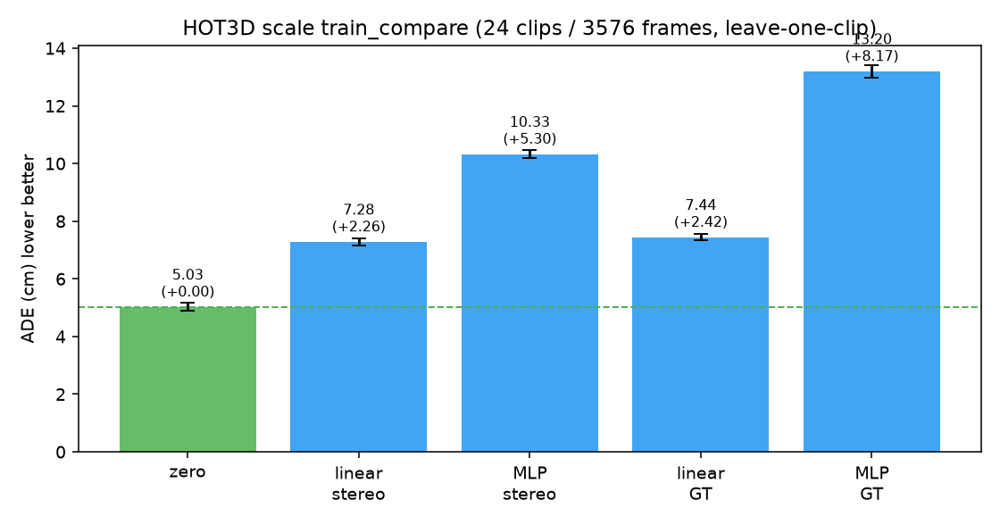

# HOT3D 扩大训练对比（24 clips）

**日期**：2026-10-11 · **机器**：Ubuntu RTX 4090  
**数据**：`run_stereo_pipeline.py --hot3d`，24 段 Quest3，每段最多 150 帧 → **3576** 行；QC 通过 21/24；双目标签覆盖均值 **79%**  
**评测**：留一片段；目标=GT 手腕增量；H=16；与 `egodex_act_eval` 同指标  
**脚本**：`scripts/hot3d_train_compare.py --tune 0 --steps 2000 --seeds 5`

## 标签质量（相对动捕 GT）

| 来源 | 手腕误差中位 cm | 均值 cm | 有效关节对数 |
|---|---|---|---|
| stereo（双目流水线） | **1.24** | 2.70 | 5090 |

双目标签已经很准（中位 ~1.2 cm），问题不在「标歪了」。

## 训练 ADE（cm，越低越好）

| 方法 | ADE | 相对零动作 | 95% CI |
|---|---|---|---|
| **零动作** | **5.026** | 0 | [4.89, 5.18] |
| 线性 · 双目 | 7.283 | +2.256 | [7.15, 7.41] |
| MLP · 双目 | 10.326 | +5.300 | [10.18, 10.48] |
| 线性 · GT | 7.444 | +2.418 | [7.33, 7.56] |
| MLP · GT | 13.196 | +8.170 | [12.97, 13.42] |

## 结论

1. **扩大到 24 段后，零动作仍是最强基线（ADE ≈ 5.0 cm）**；线性/MLP（双目或 GT）都更差。
2. 双目标签 vs GT 手腕中位 **1.24 cm**，说明「标签更准 ≠ 这个 BC 设定下更好训」——和早期 4 段结论一致，只是零动作从 4.37→5.0（数据/划分不同）。
3. 下一步更该改 **动作表示 / 模型（图像 ACT、更长上下文）或任务设定**，而不是继续只堆双目帧数。

指标：`outputs/hot3d_scale/train/metrics.json`
