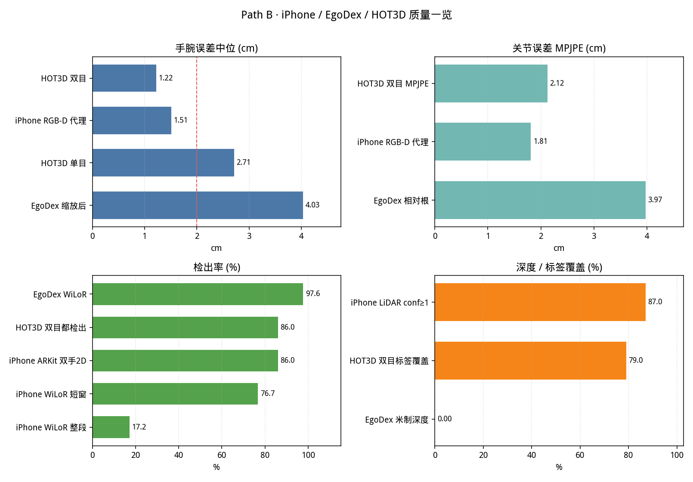
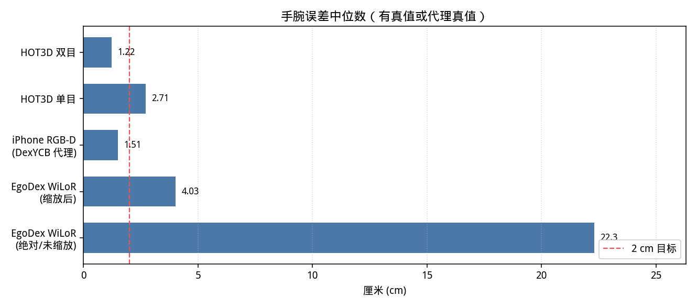
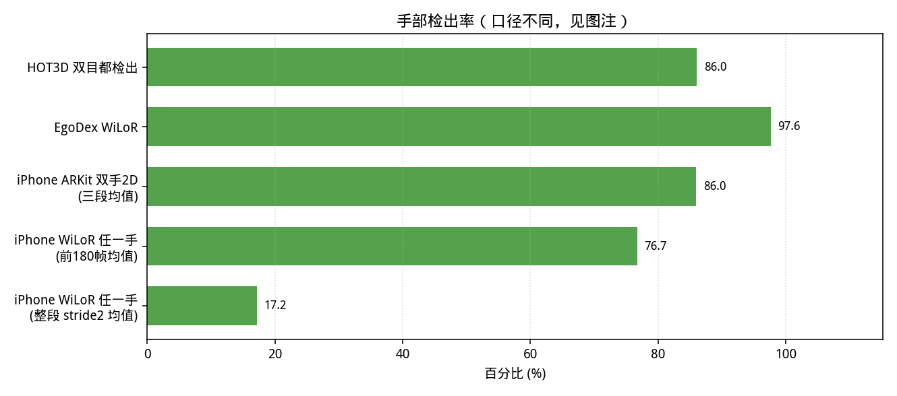
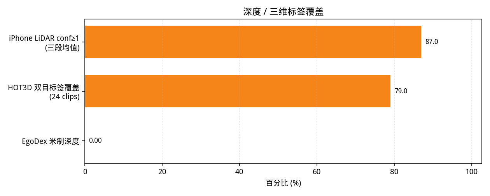
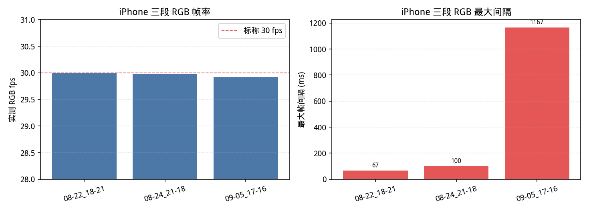

# Path B：iPhone vs EgoDex vs HOT3D 数据质量对比

**日期**：2026-10-11 · **机器**：Ubuntu RTX 4090  
**目的**：用初学者也关心的几项指标，说明我们现在的 iPhone 采集数据，相对公开集（EgoDex、HOT3D）好在哪、短在哪。  
**图**：本目录 `quality_*.png`；数字汇总 `quality_metrics.json`。

## 一句话结论

1. **采集层（帧率 / 深度 / 机载手 2D）**：3 段 Pro Max 很稳——RGB ≈ **30.0 fps**，深度帧数与彩色 **一一对应**，LiDAR 有效深度约 **81–91%**，机载双手 2D 检出 **81–91%**。
2. **三维标签精度（有真值时）**：HOT3D 双目手腕中位 **1.22 cm** 仍是上限参照；用 DexYCB 模拟 iPhone 深度分辨率时，RGB-D 融合手腕中位 **1.51 cm**，接近双目。EgoDex 上 WiLoR 相对根 MPJPE ≈ **4.0 cm**，但**绝对手腕**未缩放约 **22 cm**（单目没米制深度）。
3. **训练可用的三维手**：整段 WiLoR+LiDAR「任一手有效」均值只有约 **17%**（出画/静止多）；前 180 帧活跃窗口约 **77%**。质量故事要写清「采集很稳 ≠ 每帧都有可训三维手」。

---

## 1. 手腕 / 关节误差（越小越好）

| 来源 | 手腕误差中位 | 关节 MPJPE | ≤2 cm 比例 | 真值？ |
|---|---|---|---|---|
| **HOT3D 双目三角化** | **1.22 cm** | 2.12 cm | 75% | 有 MANO |
| HOT3D 单目 WiLoR | 2.71 cm | 4.09 cm | 33% | 有 |
| HOT3D 24 clips 双目 vs GT | **1.24 cm** | — | — | 有 |
| **iPhone RGB-D（DexYCB 代理）** | **1.51 cm** | 1.81 cm | 72% | 代理真值 |
| EgoDex WiLoR 相对根 / 缩放后手腕 | 缩放后 4.03 cm | 3.97 cm | 绝对 0% | 有 ARKit |
| EgoDex WiLoR 绝对手腕（未缩放） | 22.3 cm | — | 0% | 有 |

> 真实 iPhone mcap **没有**头戴动捕真值，所以「iPhone 能到多准」用 DexYCB 上模拟 iPhone 深度分辨率的 RGB-D 结果作代理（见 `docs/iphone_capture_eval.md`）。那是第三视角桌面相机，不能直接当成头戴误差。

---

## 2. 手部检出率

| 来源 | 口径 | 检出率 |
|---|---|---|
| HOT3D | 左右目都检出（WiLoR） | **86.0%**（左 91.6% / 右 90.1%） |
| EgoDex | WiLoR 单目检出 | **97.6%** |
| iPhone 机载 | ARKit 双手 2D（索引） | 三段 **91.5% / 85.4% / 81.0%**（均 86.0%） |
| iPhone WiLoR | 任一手有效 · 前 180 帧 | 87% / 91% / 53%（均 77%） |
| iPhone WiLoR | 任一手有效 · 整段 stride=2 | 16% / 8% / 28%（均 17%） |

机载 2D 高、整段 WiLoR 三维低：QC 报告里「手出画」「摆拍/静止」占大多数坏帧（见 `outputs/iphone_mcap/run_s2/report.md`）。论文 B 部分应把这两层分开写。

---

## 3. 深度覆盖与同步

| 片段 | 深度 conf≥1 | conf=2 | 会话 depth_valid | RGB 帧 = 深度帧 | IMU Hz |
|---|---|---|---|---|---|
| 2026-08-22_18-21 | 81.0% | 69.9% | 79.2% | 是 (25675) | 99.8 |
| 2026-08-24_21-18 | 90.9% | 84.6% | 90.8% | 是 (27843) | 99.9 |
| 2026-09-05_17-16 | 89.1% | 79.4% | 89.8% | 是 (39720) | 99.9 |
| **均值** | **87.0%** | — | — | 三段均匹配 | ≈99.9 |

| 对照 | 深度 / 三维标签 |
|---|---|
| HOT3D 24 clips 双目标签覆盖 | 79% |
| EgoDex | **无**主动深度；靠 ARKit 位姿 |

---

## 4. 帧率稳定性（iPhone 三段）

| 片段 | 实测 RGB fps | 周期中位 / P99 (ms) | 最大间隔 (ms) | 深度 fps |
|---|---|---|---|---|
| 2026-08-22_18-21 | **29.988** | 33.343 / 33.354 | 66.7 | 30.0 |
| 2026-08-24_21-18 | **29.985** | 33.343 / 33.353 | 100.0 | 30.0 |
| 2026-09-05_17-16 | **29.916** | 33.343 / 33.353 | 1167.0 | 29.9 |

- 前两段最大间隔 ≤100 ms；**09-05** 出现过 **1167 ms** 的大间隔（详细分析已标「待复核」），写论文时要当例外披露。
- 周期 P99 仍在 33.35 ms 附近 → 绝大多数时间锁在 30 fps。

---

## 5. 对论文 Path B 意味着什么

| 主张 | 证据够不够 | 还要补什么 |
|---|---|---|---|
| 「手机采集管线稳、深度齐」 | **够**：fps / RGB=Depth / LiDAR 覆盖 | 深度字节序已在适配器约定；继续抽样交叉验证 |
| 「三维手精度接近双目」 | **代理够、真机不够**：DexYCB 1.51 cm；头戴无 GT | 双目硬件回来后在同场景重测；或桌面标定板/OptiTrack |
| 「比 EgoDex 更有米制深度」 | **够**：EgoDex 绝对手腕 ~22 cm vs 我们有 LiDAR | 在相同任务上并排训策略（Path C） |
| 「每帧都适合训练」 | **不够**：整段 WiLoR 有效手偏低 | 采集时双手入画、少静止；QC 后有效动作比例写进表 |

---

## 6. 数据来源与复现

- HOT3D：`docs/hot3d_stereo/results.md`，`docs/hot3d_stereo/train_compare_scale.md`
- EgoDex WiLoR：`docs/reviv_compare.md`（相对根 MPJPE ≈ 3.97 cm）
- iPhone 管线：`outputs/iphone_mcap/run_s2/`，`sessions_s2/*/metadata.json`
- iPhone 采集质检：本地 `视频审核_收藏_20260907-1623_详细分析.xlsx`（按用户要求不入库，只作参考）
- DexYCB 代理：`docs/iphone_eval/dexycb_summary.json`
- 本页图表：`python scripts/iphone_quality_compare.py`

指标 JSON：[`quality_metrics.json`](quality_metrics.json)

