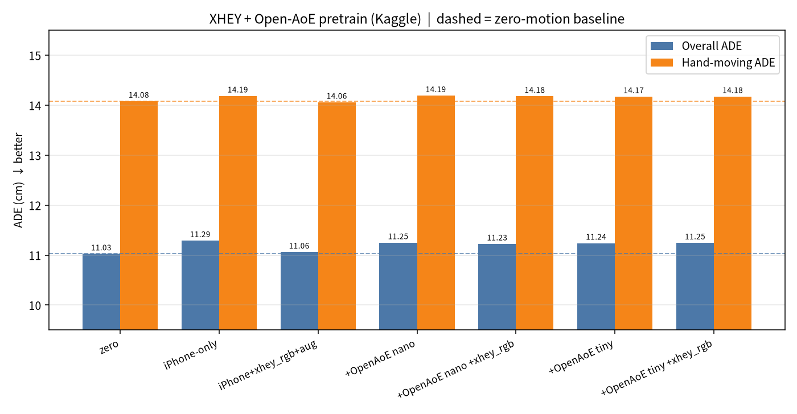

# Open-AoE 预训练试一下（给新手）

一句话：**用别人的 2000 小时第一视角手部数据先练，再在你的 iPhone 数据上微调——这次没帮上忙。**

---

## Open-AoE 是什么

[Open-AoE / OpenAoE-2000h](https://huggingface.co/datasets/inclusionAI/OpenAoE-2000h)（arXiv:2607.14183）是公开的第一视角手部大数据。我们只用了手腕相关的 `hands.npz` + `camera_traj.npz`（不管画面），转成和 XHEY 一样的 15 fps 手腕增量。

**许可：** Open-AoE 许可允许商用，但要署名；其中 MANO 推出来的手部参数另受 **MANO 许可**（非商用）约束。

---

## 我们做了什么

```
Open-AoE nano / tiny  →  convert_openaoe.py  →  统一 episode
        ↓
  XHEY 预训练（Kaggle GPU）→  iPhone 3 段留一法评测
```

| 切片 | 预训练步数 | Open-AoE 行数 | 说明 |
|---|---|---|---|
| nano | 6000 | ~13.7 万 | HF `nano` 标签，~2.5 h「手在动」 |
| tiny | 20000 | ~74.6 万 | 500 段随机切片，~13.9 h |

评测：3 段 iPhone 激光雷达留一法，3 个随机种子，指标是手腕 ADE（cm）。

---

## 一张图



虚线 = 「手完全不动」基线（overall 11.03 cm / 手在动 14.08 cm）。**柱子越低越好。**

---

## 数字表（cm）

| 配比 | Overall ADE | 手在动 ADE | vs zero（overall） |
|---|---:|---:|---:|
| zero（不动） | **11.03** | **14.08** | 0 |
| iPhone-only | 11.29 | 14.19 | +0.27 |
| iPhone+xhey_rgb+aug | 11.06 | 14.06 | +0.04 |
| +OpenAoE nano | 11.25 | 14.19 | +0.22 |
| +OpenAoE nano +xhey_rgb | 11.23 | 14.18 | +0.20 |
| +OpenAoE tiny | 11.24 | 14.17 | +0.21 |
| +OpenAoE tiny +xhey_rgb | 11.25 | 14.18 | +0.22 |

原始 JSON：[`docs/xhey/openaoe_metrics.json`](xhey/openaoe_metrics.json)。Kaggle：`justinz2010/xhey-openaoe-train`。

---

## 诚实结论

**Open-AoE 预训练对 XHEY 手腕 ADE 没有帮助。**  
所有带 `+openaoe` 的配比都比「手不动」差，也比最好的非 AoE 配比（`iPhone+xhey_rgb+aug`）差。

可能原因（猜测，未验证）：世界系 / 坐标系仍有偏差；数据是「无画面」姿态预训练，和 iPhone 画面特征对不上；手腕增量分布和你的家务动作差太远。

下一步别在 Open-AoE 上加量了，去试别的方向（见 [`docs/xhey_ledger.md`](xhey_ledger.md)）。

---

## 怎么复现

```bash
# 1) 转换（需本地 MANO + smplx）
python scripts/convert_openaoe.py --root data/openaoe/nano --out data/openaoe/unified/nano \
    --mano-dir /path/to/mano_parent

# 2) 训练消融（Kaggle 脚本见 kaggle/openaoe/run.py）
python scripts/train_xhey.py --ablation --mixes iphone,iphone+openaoe+aug \
    --openaoe data/openaoe/unified/nano --pre-steps 6000 --move-cm 5
```

**署名：** 使用 Open-AoE 数据时请注明 Open-AoE / OpenAoE-2000h（arXiv:2607.14183）。
