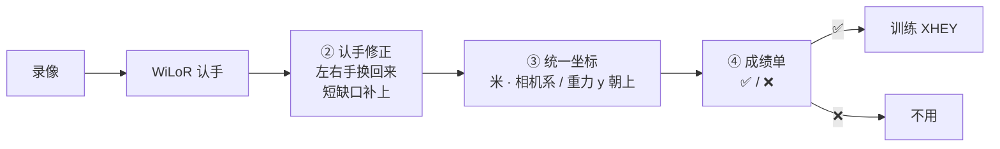
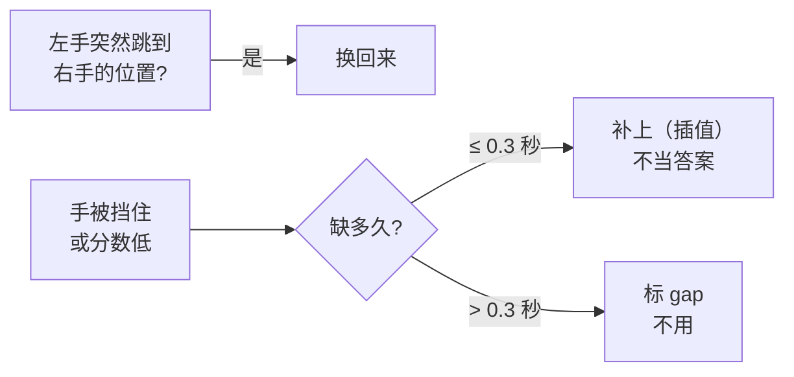
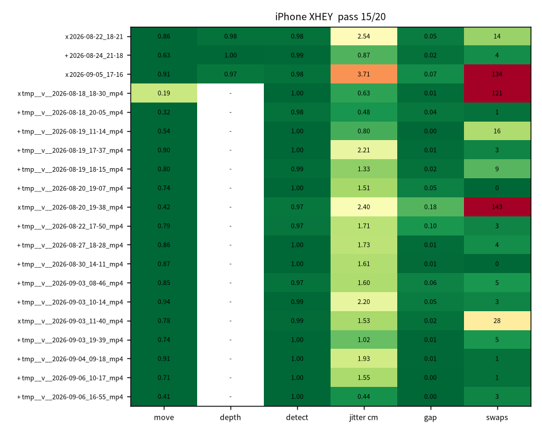
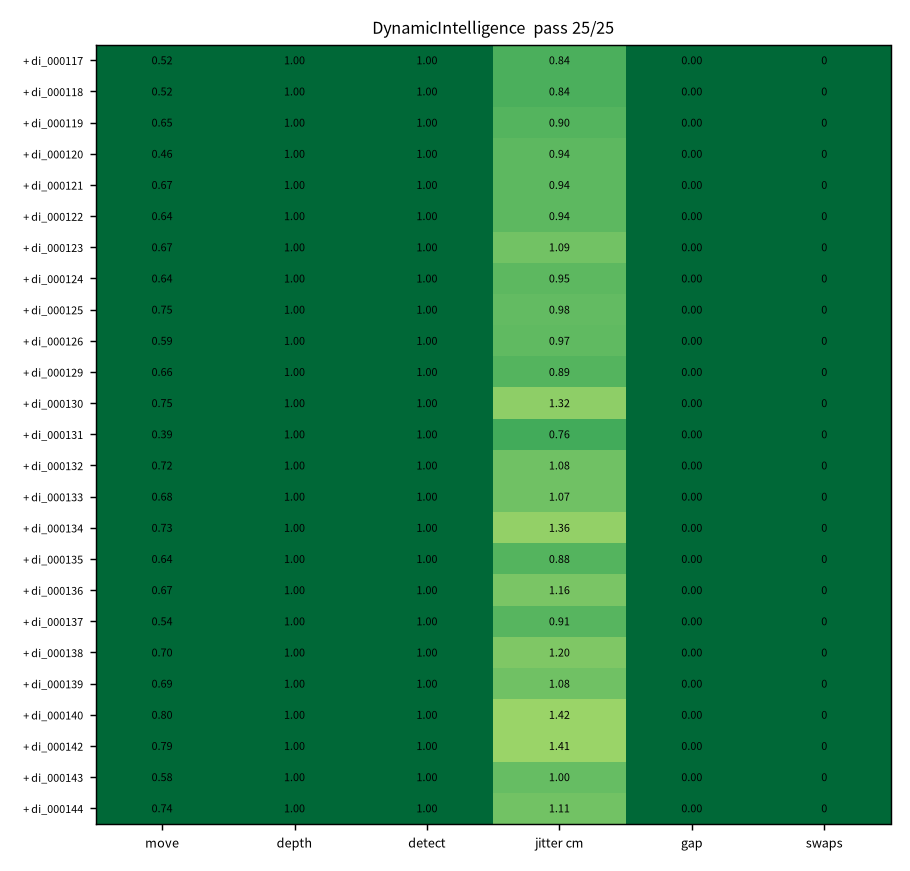
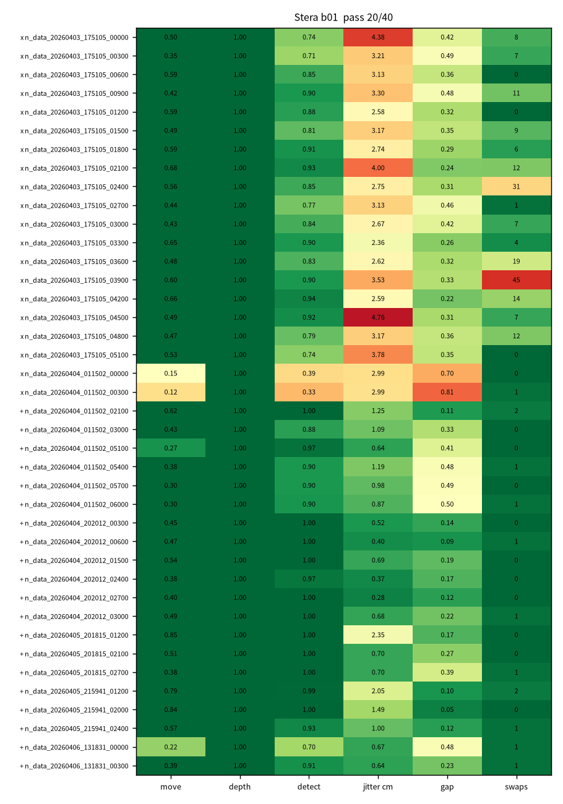

# 管线三处补强：认手修正 · 统一坐标 · 自动成绩单

> 一句话：**先把手认对，再把坐标对齐，最后给每段录像打分，不合格的不进训练。**



## ② 认手修正（`scripts/egodata/hand_fix.py`）



已经自动接在 iPhone 深度管线和 `wilor_video_to_episodes.py` 里（`--no-hand-fix` 可关掉对比）。

## ③ 统一坐标（`scripts/common/frames.py`）

| 名字 | 怎么摆 | 谁在用 |
|---|---|---|
| `camera` | x 右 · y 下 · z 前 | WiLoR、Open-AoE |
| `camera_yup` | x 右 · y 上 · z 后 | DynamicIntelligence |
| `world_yup` | 重力朝下，y 朝上 | Stera |
| `world` | 公制世界，**上方向没核实** | 你的 iPhone mcap |

单位全部是 **米**。`sanity_check` 会抓两类错：手离相机 30 m（cm 当成了 m），手跑到相机背后（轴反了）。

⚠️ 新发现：你的 iPhone mcap 里的世界系，「上」**不是 y**（像是 z 朝上）。现在只提醒、不改数据。

## ④ 成绩单（`scripts/qc_scorecard.py`）

| 指标 | 意思 | 合格线 |
|---|---|---|
| 动 | 手在动的时间占比 | ≥ 5% |
| 深度 | 深度能用的比例 | ≥ 50% |
| 认手 | 认到手的比例 | ≥ 50% |
| 抖 | 手腕每帧挪多少 | ≤ 2.5 cm |
| 换手 | 左右手认反次数 | ≤ 10 次/分钟 |
| 缺口 | 长缺口占比 | ≤ 50% |

```bash
python scripts/qc_scorecard.py --episodes <episode 目录> --out outputs/qc/<名字>
python scripts/train_xhey.py ... --qc-filter outputs/qc/<名字>/scorecards.json
```

## 实测结果（2026-10-14，云电脑 CPU）

| 数据 | 段数 | 合格 | 动 | 认手 | 抖 | 缺口 | 主要问题 |
|---|---|---|---|---|---|---|---|
| 你的 iPhone | 20 | **15** | 78% | 99.7% | 1.58 cm | 2% | 左右手认反 3 段、抖 2 段 |
| DynamicIntelligence | 25 | **25** | 67% | 100% | 0.99 cm | 0% | — |
| Stera（第 1 批） | 757 | **199** | 47% | 88% | 1.79 cm | 34% | 换手、缺口多、抖 |

（数字都是中位数；DI 和 Stera 没导出逐帧深度状态，深度一栏默认按 100% 记。）

你的 iPhone：



DynamicIntelligence：



Stera（只画了最差 20 段 + 合格的前 20 段）：



**结论**：你的录像认手很全、缺口很少。最需要注意的是 **左右手认反**（`08-18_18-30`、`08-20_19-38`、`09-03_11-40`）和 **3 段有深度的里有 2 段太抖**（`08-22_18-21`、`09-05_17-16`）。
