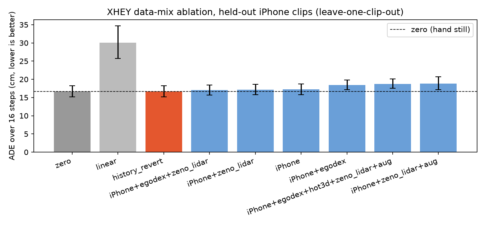
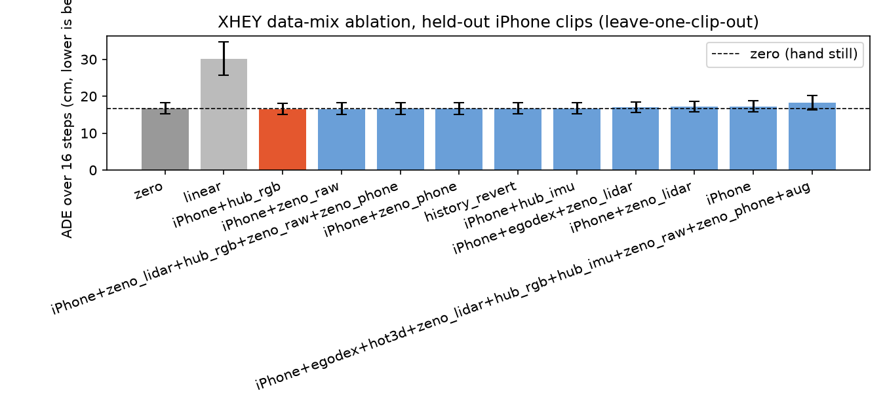
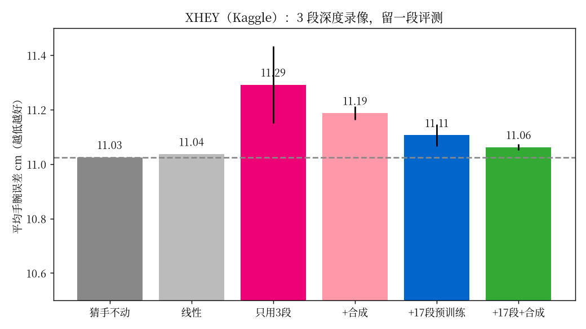
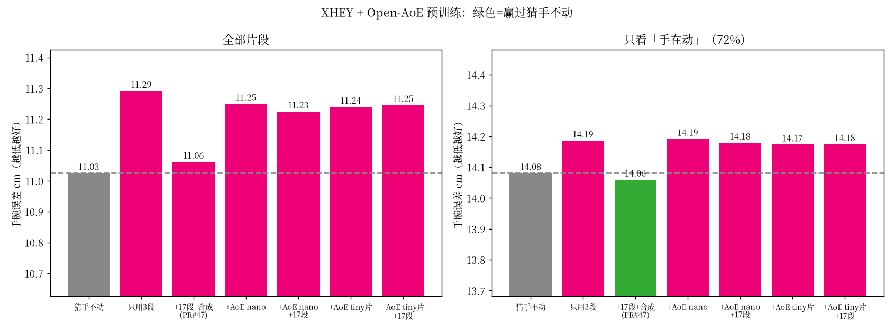

# XHEY 模型说明（给新手）

一句话：**XHEY 是用你 xhey App 在 iPhone（带激光雷达）上采的第一视角录像，训练出来的「下一秒双手手腕怎么动」的模型。**

名字来自采集 App **xhey**。它不是直接控制机械臂，而是先学「人手手腕接下来怎么动」；后面再用现成的人手→机械臂映射接到机器人上。

---

## 它看什么、预测什么

| 输入 | 含义 |
|---|---|
| 画面 | 当前帧经 ResNet18（ImageNet 预训练，冻结）得到 512 维特征 |
| 当前手 | 21 个关节相对手腕的位置 + 两手腕朝向 + 两手相对位置（137 维） |
| 历史 | 最近 8 帧手腕相对当前位置（模拟 ACT 的多帧观测） |

| 输出 | 含义 |
|---|---|
| 16 × 14 | 未来约 1 秒（15 fps × 16 步）双手手腕增量：每只手 xyz + 四元数 |

训练时只在「这只手真的测到了」的步骤上算损失（`action_valid` 掩码，等价于 ACT 的 `action_is_pad`）。预测的是相对「手不动」的残差，再乘一个小的 shrink 系数，避免乱晃。

---

## 数据从哪来

| 来源 | 用途 | 规模 | 许可 |
|---|---|---|---|
| **iPhone Pro Max + 激光雷达**（xhey `.mcap`） | 主数据 + **唯一留出评测** | 3 段整段，stride=2，约 4.6 万帧 / 15 fps | 自有 |
| **zeno_lidar**（HF iPhone LiDAR 家务） | 预训练（米制手腕，优先） | 8 段 → 约 6.4 万行 / 15 fps，valid≈0.88 | **CC BY-NC 4.0** |
| **EgoDex**（开源，Apple） | 预训练 | 309 段，约 1.4 万行 | 按 EgoDex 条款 |
| **HOT3D**（开源双目） | 预训练 | 24 段，约 1.8 千行 | 按 HOT3D 条款 |
| **hub_rgb / hub_imu**（HF Hubdata） | 预训练（WiLoR 相机系） | 各截取前约 300 帧/段 | **other**（见数据集 LICENSE） |
| **zeno_raw / zeno_phone**（HF 开放样例） | 预训练（WiLoR） | 样例视频截取 | **CC BY-NC 4.0** |
| **合成增强 `aug`** | 扩大 iPhone 训练集 | 镜像换手、2 倍速、输入噪声 | — |

本地镜像与转换说明：[`docs/hf_iphone_data.md`](hf_iphone_data.md)。媒体很大，不进 git。

所有来源都统一成：**140 维状态、14 维手腕增量、horizon=16**。开源数据没有画面时，画面特征置 0，并加一个 `has_image` 开关，模型知道「这次没画面」。

---

## 一条命令怎么训

先进入已装好的环境（本机）：

```bash
cd /mnt/sda/app/robot
source outputs/hot3d_scale/venv/bin/activate
```

**默认：iPhone + EgoDex 预训练 + 合成增强，训完保存模型：**

```bash
python scripts/train_xhey.py
```

**要看各种数据配比谁有用（消融）：**

```bash
python scripts/train_xhey.py --ablation
```

常用参数：

| 参数 | 含义 | 默认 |
|---|---|---|
| `--mix` | 最终模型用哪些数据，用 `+` 连接（含 `zeno_lidar` / `hub_rgb` / `hub_imu` / `zeno_raw` / `zeno_phone`） | `iphone+egodex+aug` |
| `--ablation` | 跑一整套配比对比 | 关 |
| `--seeds` | 每种配比训几个随机种子 | 3 |
| `--steps` | iPhone 微调最大步数 | 3000 |
| `--pre-steps` | 开源预训练步数 | 6000 |
| `--out` | 结果目录（含 `xhey.pt`、`metrics.json`、图） | `outputs/xhey` |

结果（不进 git）：`outputs/xhey/xhey.pt`、`metrics.json`、`xhey_results.png`。

EgoDex 子集若还没有，可先：

```bash
cd data/egodex_sub && python fetch.py   # 约 309 段 hdf5
cd ../.. && python scripts/convert_egodex.py --input data/egodex_sub/raw --out data/egodex_sub/unified --workers 16
```

HOT3D 用现成的 `outputs/hot3d_scale/run/episodes`。

---

## 实验结果

> 2026-10-12 review 修复说明：下表保留为历史实验记录。旧 MCAP 抽帧曾在 HEVC 解码前丢参考帧，
> 开放 RGB 视频的 WiLoR 未传真实内参，增强样本还包含内部验证时段。
> 修复后需要重新转换 MCAP、用 `--calib` 重做开放 RGB 标签，再重新训练并评估；
> 当前这些配比排名暂不作为已验证结论。缓存会按源文件变化和公制校验状态重建。

评测方式：**留一段交叉验证**（Justin 的 3 段 iPhone，训 2 测 1）。主指标 ADE = 未来 16 步手腕累计位移误差（厘米，越小越好）。「猜手不动」是硬基线。

> 三段整段里有效三维手大约 **3.8%**，完整 16 步评测块大约 **32 个**。数字波动大，只能当方向参考。

### Wave 1：加入 HF zeno iPhone LiDAR（`outputs/xhey_hf/`，seeds=2）

| 方法 | ADE (cm) ↓ | 相对 zero | 前缀 ADE (cm) ↓ |
|---|---:|---:|---:|
| **zero（手不动）** | **16.68** | 0 | **18.61** |
| history_revert | 16.68 | 0 | 18.79 |
| XHEY · iPhone + EgoDex + zeno_lidar | 17.01 | +0.33 | 18.74 |
| XHEY · iPhone + zeno_lidar | 17.14 | +0.46 | 19.48 |
| XHEY · iPhone only | 17.22 | +0.54 | 18.83 |
| XHEY · iPhone + EgoDex | 18.45 | +1.77 | 19.02 |
| XHEY · iPhone + EgoDex + HOT3D + zeno_lidar + aug | 18.76 | +2.08 | 19.78 |
| XHEY · iPhone + zeno_lidar + aug | 18.83 | +2.15 | 20.10 |
| linear BC | 30.07 | +13.39 | 28.86 |



zeno_lidar 预训练把最好配比从「只 iPhone」推到了 **iPhone+EgoDex+zeno_lidar（17.01）**，仍略差于 zero（16.68）。**没有任何配比赢过 zero。**

### Wave 2：再加 Hubdata / zeno WiLoR（`outputs/xhey_hf_w2/`，seeds=2）

外部行数：hub_rgb 5980、hub_imu 3588、zeno_raw 4784、zeno_phone 1495、zeno_lidar 64412。

| 方法 | ADE (cm) ↓ | 相对 zero | 前缀 ADE (cm) ↓ |
|---|---:|---:|---:|
| **XHEY · iPhone + hub_rgb** | **16.45** | **−0.23** | 18.62 |
| XHEY · iPhone + zeno_raw | 16.54 | −0.14 | 18.62 |
| XHEY · iPhone + zeno_lidar + hub_rgb + zeno_raw + zeno_phone | 16.61 | −0.07 | 18.66 |
| XHEY · iPhone + zeno_phone | 16.65 | −0.03 | 18.74 |
| **zero（手不动）** | **16.68** | 0 | **18.61** |
| history_revert | 16.68 | 0 | 18.79 |
| XHEY · iPhone + hub_imu | 16.68 | 0.00 | 18.61 |
| XHEY · iPhone + EgoDex + zeno_lidar | 17.01 | +0.33 | 18.74 |
| XHEY · iPhone + zeno_lidar | 17.14 | +0.46 | 19.48 |
| XHEY · iPhone only | 17.22 | +0.54 | 18.83 |
| XHEY · 全开源 + aug | 18.17 | +1.49 | 19.57 |
| linear BC | 30.07 | +13.39 | 28.86 |



**有配比赢过 zero**：最好是 `iphone+hub_rgb`（ADE 16.45，比 zero 好 0.23 cm）。`zeno_raw` / `zeno_phone` 也略好于 zero。差距很小，且评测块仍只有约 32 个，需要更多自有有深度数据再确认。

---

## 诚实结论

1. **Wave 2 首次出现赢过「猜手不动」的配比**：`iphone+hub_rgb` ADE **16.45** vs zero **16.68**（−0.23 cm）。`zeno_raw`、`zeno_phone` 也略胜。
2. **米制 zeno_lidar  alone 仍不够翻盘**（17.14）；和 EgoDex 搭配到 17.01。WiLoR 相机系的手机 RGB 预训练反而在这个极小留出集上更有效——可能因为动作更「家务」、或 shrink 选到更保守的预测。
3. **堆全部开源 + aug 会变差**（18.17）。不是越多越好。
4. **评测仍极窄**（有效手 ~3.8%，完整块 ~32）。论文里只能当方向信号，不能当最终证明。
5. **下一步**：再采 10+ 段自有 Pro 深度；可选把剩余 20 段 hub_rgb 也跑完 WiLoR。
6. **许可**：zeno-* = CC BY-NC（非商用）；Hubdata = other，商用前读 LICENSE。

---

## 和仓库里其他东西的关系

- 数据来自 `outputs/iphone_mcap/run_s2`（见 `docs/iphone_arxiv_plan.md`、`docs/iphone_mcap/`）。
- 评测指标复用 `scripts/egodex_act_eval.py`。
- 状态/动作打包复用 `scripts/egodata/lerobot_export.py` 的 `pack_state` / `pack_action`。
- 脚本：`scripts/train_xhey.py`；HF 转换：`scripts/convert_hf_iphone.py`、`scripts/wilor_video_to_episodes.py`。

---

## 2026-10 Kaggle 重训结果（20 段 xhey 录像）



**怎么看这张图：** 柱子越矮越好。灰色虚线是「猜手不动」（什么都不学）。柱子要低于虚线，模型才算学到东西。

| 方案 | 用了什么数据 | 误差 (cm) | 比「猜手不动」 |
|---|---|---|---|
| 猜手不动 | — | **11.03** | 基准 |
| 线性 | 3 段深度 | 11.04 | +0.01 |
| XHEY 只用 3 段 | 3 段深度 | 11.29 | +0.27 ❌ |
| + 合成 | 3 段 + 镜像/2 倍速 | 11.19 | +0.16 |
| + 17 段预训练 | 先学 17 段无深度，再学 3 段 | 11.11 | +0.08 |
| **+ 17 段 + 合成** | 全部 | **11.06** | +0.04（最好） |

**三句话结论**
1. ✅ 管线（路径 A）跑通：3 段深度录像全长 46,617 帧，QC 全部通过，标注覆盖 92–99%；另外 17 段无深度录像共 30,583 帧，WiLoR 认手有效率 91%。
2. ✅ 你自己的 17 段录像预训练有用（路径 C）：误差从 11.29 降到 11.06 cm，3 个随机种子都稳定。
3. ❌ 但还没赢过「猜手不动」：差距只剩 0.04 cm。主要原因是录像里手大部分时间在慢动，要多录有明显伸手、抓取动作的片段。

> 和旧数字（猜手不动 16.68 / 最佳 16.45 cm）**不能直接比**：这次用了 PR #46 修正后的对齐与评测，标签也是在 Kaggle 上重新生成的，基准本身降到了 11.03。只看同一次运行里的相对差距。

**怎么复现**：box 上的 `/workspace/xhey_kaggle/prep_all.sh` 预处理 → Kaggle 私有数据集 `justinz2010/xhey-iphone-sessions` → 内核 `justinz2010/xhey-wilor-labels`（T4，约 10.5 小时，其中 WiLoR 认手约 7.5 小时）。训练命令：

```bash
python scripts/train_xhey.py --run run_s2 --ablation \
  --mixes iphone,iphone+aug,iphone+xhey_rgb,iphone+xhey_rgb+aug \
  --mix iphone+xhey_rgb+aug --xhey-rgb xhey_rgb_unified --seeds 3
```

---

## 2026-10 加入 Open-AoE 预训练（开源手机第一视角数据）



**怎么看：** 左图是全部片段，右图只看「手真的在动」的片段（未来约 1 秒手腕移动超过 5 cm，占 72%）。灰色虚线是「猜手不动」。**绿色柱子 = 赢过它**，红色 = 没赢。

| 方案 | 全部 (cm) | 手在动 (cm) | 手在动时比「猜不动」 |
|---|---|---|---|
| 猜手不动 | 11.03 | 14.08 | 基准 |
| 只用 3 段 | 11.29 | 14.19 | +0.11 ❌ |
| **+17 段 + 合成（PR #47）** | 11.06 | **14.06** | **−0.02 ✅**（95% 区间 −0.028 ~ −0.015） |
| + Open-AoE nano | 11.25 | 14.19 | +0.11 ❌ |
| + Open-AoE nano + 17 段 | 11.23 | 14.18 | +0.10 ❌ |
| + Open-AoE tiny 切片 | 11.24 | 14.17 | +0.09 ❌ |
| + Open-AoE tiny 切片 + 17 段 | 11.25 | 14.18 | +0.09 ❌ |

**三句话结论**
1. ✅ 在「手在动」的片段上，PR #47 的 XHEY（17 段自有录像预训练 + 合成）**第一次小幅赢过「猜手不动」**：14.06 vs 14.08 cm，3 个种子、置信区间都在 0 以下。差距很小（0.02 cm），还不能说「很强」。
2. ❌ 加 Open-AoE（nano 2.5 小时、tiny 切片 13.9 小时的「手在动」片段）**反而变差**约 0.1–0.2 cm，而且数据越多没有越好。
3. 🤔 可能原因：Open-AoE 世界坐标没有重力方向（我们只是把 y 轴翻过来近似）、手的标注来自 MANO 重建而不是 LiDAR、拍摄人和动作分布不同。下一步应改成「相机坐标系」下预训练，或只拿 Open-AoE 学手指形状。

**用到的数据**

| 档 | 片段 | 过滤后（手在动）| 说明 |
|---|---|---|---|
| nano | 111 段（HF 标签 `nano`） | 503/582 个 20 秒段，13.7 万帧 @15fps | 整档 |
| tiny 切片 | 从 main 随机抽 500 段（seed 0，见 `tiny_slice.json`） | 2630/4383 段，74.8 万帧 | 整个 tiny（约 100 h）放不进 Kaggle 内存，所以切片 |

只下载了 `hands.npz` + `camera_traj.npz`（nano 约 0.24 GB），没用视频。

**怎么复现**

```bash
# 1) 只下 hands.npz / camera_traj.npz（需同意 Open-AoE 许可与 MANO 许可）
# 2) MANO 正向运动学 → 21 点、15 fps、过滤「手在动」
python scripts/convert_openaoe.py --root data/openaoe/nano --out data/openaoe/unified/nano --mano-dir /path/to/mano_parent
# 3) 训练 + 「手在动」子集评测
python scripts/train_xhey.py --run run_s2 --ablation --openaoe data/openaoe/unified/nano \
  --mixes iphone,iphone+xhey_rgb+aug,iphone+openaoe+aug,iphone+openaoe+xhey_rgb+aug --move-cm 5
```

Kaggle：私有数据集 `justinz2010/xhey-openaoe-pretrain`，内核 `justinz2010/xhey-openaoe-train`（脚本 `scripts/kaggle_xhey_openaoe.py`）。

EMPIRE（arXiv:2608.22449）没有跑：它要 PaliGemma2-3B + Depth-Anything-3 和 8 卡，而且评的是整只手的 MPJPE，XHEY 目前只预测手腕。

**致谢与许可**
- 数据来自 **Open-AoE / OpenAoE-2000h**（Hugging Face `inclusionAI/OpenAoE-2000h`；论文 *Open-AoE: An Open Egocentric Manipulation Dataset and Toolchain for Embodied Learning*，arXiv:2607.14183），按 Open-AoE Dataset License 使用，需保留署名；本仓库与 Open-AoE 无隶属或背书关系。
- `hands.npz`、`camera_traj.npz` 是 MANO 派生数据，另受 [MANO 许可](https://mano.is.tue.mpg.de/license.html)（非商业研究）约束。MANO 模型文件和转换后的数据**都不进仓库**，请各自注册下载。
