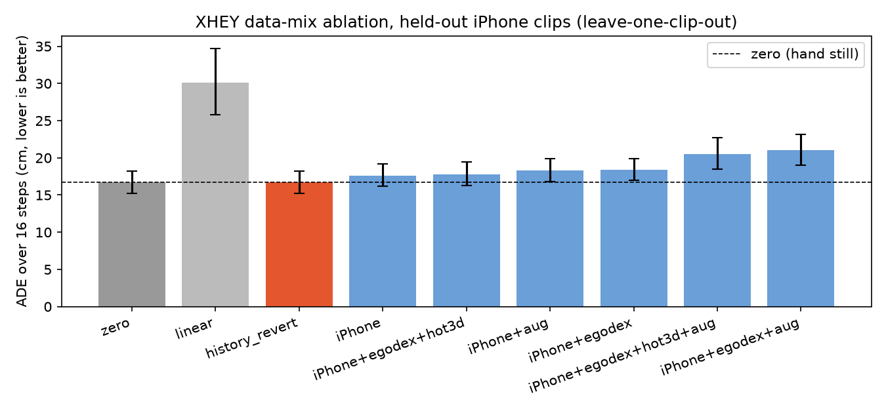

# XHEY 模型说明（给新手）

一句话：**XHEY 是用你 xhey App 在 iPhone（带激光雷达）上采的第一视角录像，训练出来的「下一秒双手手腕怎么动」的模型。**

名字来自采集 App **xhey**。它不是直接控制机械臂，而是先学「人手手腕接下来怎么动」；后面再用现成的人手→机械臂映射接到机器人上。

---

## 它看什么、预测什么

| 输入 | 含义 |
|---|---|
| 画面 | 当前帧经 ResNet18（ImageNet 预训练，冻结）得到 512 维特征 |
| 当前手 | 21 个关节相对手腕的位置 + 两手腕朝向 + 两手相对位置（137 维） |
| 历史 | 最近 8 帧手腕相对当前位置（模拟 ACT 的多帧观测） |

| 输出 | 含义 |
|---|---|
| 16 × 14 | 未来约 1 秒（15 fps × 16 步）双手手腕增量：每只手 xyz + 四元数 |

训练时只在「这只手真的测到了」的步骤上算损失（`action_valid` 掩码，等价于 ACT 的 `action_is_pad`）。预测的是相对「手不动」的残差，再乘一个小的 shrink 系数，避免乱晃。

---

## 数据从哪来

| 来源 | 用途 | 规模（这次实验） |
|---|---|---|
| **iPhone Pro Max + 激光雷达**（xhey `.mcap`） | 主数据，也是评测集 | 3 段整段，stride=2，约 4.6 万帧 / 15 fps |
| **EgoDex**（开源，Apple） | 预训练 | 抽了 309 段，约 1.4 万行动作 |
| **HOT3D**（开源双目） | 预训练 | 已有的 24 段，约 1.8 千行 |
| **合成增强 `aug`** | 扩大 iPhone 训练集 | 左右镜像并交换左右手、2 倍速下采样、输入噪声 |

所有来源都统一成：**140 维状态、14 维手腕增量、horizon=16**。开源数据没有画面时，画面特征置 0，并加一个 `has_image` 开关，模型知道「这次没画面」。

---

## 一条命令怎么训

先进入已装好的环境（本机）：

```bash
cd /mnt/sda/app/robot
source outputs/hot3d_scale/venv/bin/activate
```

**默认：iPhone + EgoDex 预训练 + 合成增强，训完保存模型：**

```bash
python scripts/train_xhey.py
```

**要看各种数据配比谁有用（消融）：**

```bash
python scripts/train_xhey.py --ablation
```

常用参数：

| 参数 | 含义 | 默认 |
|---|---|---|
| `--mix` | 最终模型用哪些数据，用 `+` 连接 | `iphone+egodex+aug` |
| `--ablation` | 跑一整套配比对比 | 关 |
| `--seeds` | 每种配比训几个随机种子 | 3 |
| `--steps` | iPhone 微调最大步数 | 3000 |
| `--pre-steps` | 开源预训练步数 | 6000 |
| `--out` | 结果目录（含 `xhey.pt`、`metrics.json`、图） | `outputs/xhey` |

结果（不进 git）：`outputs/xhey/xhey.pt`、`metrics.json`、`xhey_results.png`。

EgoDex 子集若还没有，可先：

```bash
cd data/egodex_sub && python fetch.py   # 约 309 段 hdf5
cd ../.. && python scripts/convert_egodex.py --input data/egodex_sub/raw --out data/egodex_sub/unified --workers 16
```

HOT3D 用现成的 `outputs/hot3d_scale/run/episodes`。

---

## 这次实验结果

评测方式：**留一段交叉验证**（3 段 iPhone，训 2 测 1）。主指标 ADE = 未来 16 步手腕累计位移误差（厘米，越小越好）。「猜手不动」是硬基线。

> 注意：三段整段里 WiLoR 三维手有效率只有约 **3.8%**，满足「连续 16 步双手都有效」的评测块一共只有 **32 个**。数字波动会比较大，只能当方向参考。

| 方法 | ADE (cm) ↓ | 相对 zero | 前缀 ADE (cm) ↓ |
|---|---:|---:|---:|
| **zero（手不动）** | **16.68** | 0 | **18.61** |
| history_revert（拉回历史均值） | 16.68 | 0 | 18.79 |
| **XHEY · iPhone only** | 17.60 | +0.92 | 19.14 |
| XHEY · iPhone + HOT3D + EgoDex | 17.76 | +1.08 | 19.22 |
| XHEY · iPhone + aug | 18.33 | +1.65 | 20.17 |
| XHEY · iPhone + EgoDex | 18.40 | +1.72 | 19.15 |
| XHEY · iPhone + EgoDex + HOT3D + aug | 20.54 | +3.86 | 21.03 |
| XHEY · iPhone + EgoDex + aug | 21.03 | +4.35 | 20.92 |
| linear BC | 30.07 | +13.39 | 28.86 |



---

## 诚实结论

1. **XHEY 这一轮没有赢过「猜手不动」。** 最好的配比是只用 iPhone（ADE 17.60 cm），仍然比 zero 的 16.68 cm 差一点。
2. **开源预训练 / 合成增强这次没有帮上忙。** EgoDex、HOT3D、镜像和倍速都让 ADE 变差或持平。原因很可能是：评测只看 iPhone 上极少数「双手连续有效」的块；开源数据的动作分布和这 3 段家务不完全一样；有效标签太稀。
3. **管线和命名是齐的**：一条命令能训、能评、能存 `xhey.pt`；状态/动作维度和 EgoDex ACT 实验对齐。
4. **下一步真正能拉开差距的，是更多有激光雷达深度、双手检出率更高的 iPhone 段**（目标：每类任务 10+ 段），再上带画面的完整 ACT。现在的 3 段 + 3.8% 有效率，不够支撑「模型赢了基线」的论文结论。

---

## 和仓库里其他东西的关系

- 数据来自 `outputs/iphone_mcap/run_s2`（见 `docs/iphone_arxiv_plan.md`、`docs/iphone_mcap/`）。
- 评测指标复用 `scripts/egodex_act_eval.py`。
- 状态/动作打包复用 `scripts/egodata/lerobot_export.py` 的 `pack_state` / `pack_action`。
- 脚本：`scripts/train_xhey.py`。
